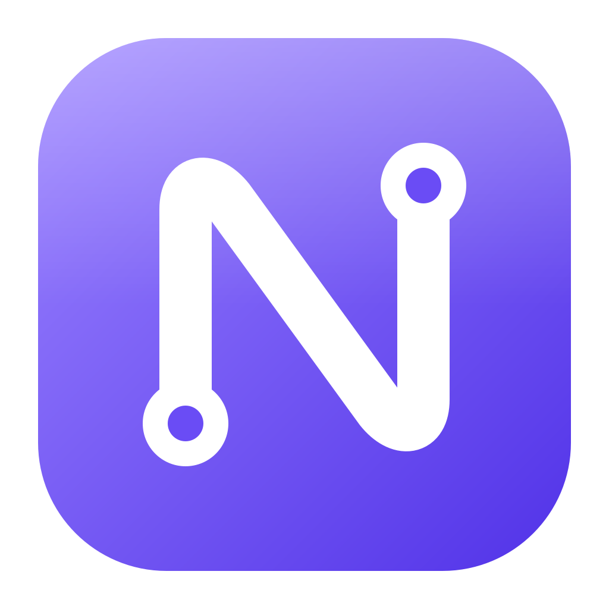
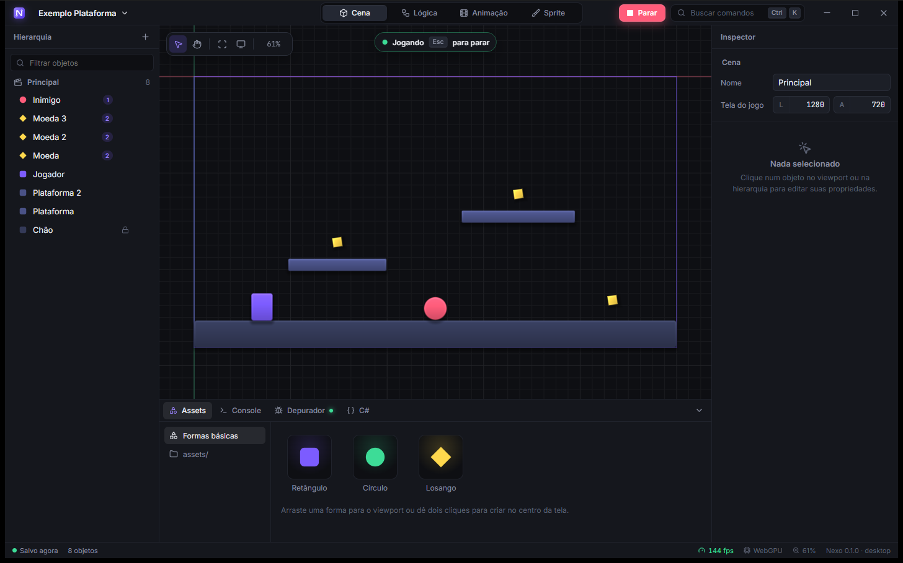
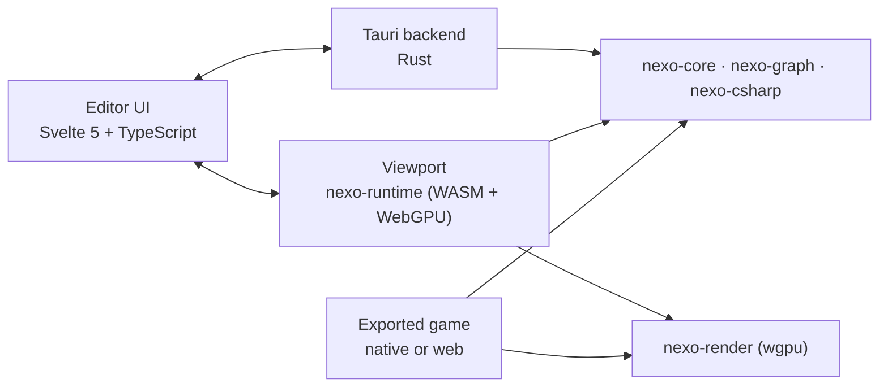

<p align="center">
  
</p>

<h1 align="center">Nexo Engine</h1>

<p align="center">
  A 2D-first game engine where <b>visual programming is the main way to build games</b>.<br/>
  Rust core · Tauri 2 editor · WebGPU viewport · C# as the textual view of every graph.
</p>

<p align="center">
  
</p>

> **Status:** Phase 0 (foundation) complete on Windows. The editor opens, renders scenes through the Rust runtime compiled to WebAssembly, plays them in the viewport and shows live generated C#. See the [roadmap](docs/07-roadmap.md) and the [backlog](docs/backlog/README.md).

## Why Nexo

- **Visual first.** Everything a game needs should be possible without typing code. Event sheets (GameMaker/Construct style) and node graphs (Blueprint style) share one model.
- **Everything is a node.** Scenes are trees of typed nodes, like Godot: `Sprite2D`, `CharacterBody2D`, `Area2D`, `Camera2D`... You change behavior by changing node types and properties.
- **Unity-grade editor.** Familiar layout (Hierarchy, Scene/Game, Inspector, Project, Console), dense and organized, fast.
- **No black box.** Every graph can be read as clean C#, so learning visually teaches real programming.
- **Light.** Small installer thanks to Tauri; the same runtime powers the editor viewport, desktop builds and web builds.

## Architecture



## Getting started

Requirements: Rust (with `wasm32-unknown-unknown`), `wasm-bindgen-cli` 0.2.129, Node 20+, pnpm. On Windows: Visual Studio Build Tools (C++) and WebView2.

```bash
rustup target add wasm32-unknown-unknown
cargo install wasm-bindgen-cli --version 0.2.129 --locked
cd editor
pnpm install
pnpm dev        # desktop app (Tauri) with hot reload
pnpm dev:web    # UI only, in the browser at http://localhost:1420
pnpm build      # desktop installer
```

## Repository layout

| Path | Purpose |
|---|---|
| `crates/nexo-core` | Shared types (camera, sprite instances, later the node tree) |
| `crates/nexo-render` | 2D renderer on wgpu (native, WebGPU, WebGL2) |
| `crates/nexo-runtime-web` | Runtime compiled to WASM for the editor viewport and web export |
| `editor/src` | Editor UI (Svelte 5) |
| `editor/src-tauri` | Tauri backend: projects, scenes, file system |
| `docs/` | Vision, architecture, research, backlog, decisions |

## Documentation

| Document | Content |
|---|---|
| [Vision](docs/01-vision.md) | Audience, value proposition, differentiators |
| [Engine research](docs/research/README.md) | Deep study of Unity, Godot and GameMaker, with sources |
| [Architecture](docs/03-architecture.md) | Tauri, Rust, rendering, node tree, project format, export |
| [Visual programming](docs/04-visual-programming.md) | Event sheets, node graphs, IR, VM, C# generation |
| [Editor UI & UX](docs/05-editor-ui.md) | Unity-style design system and layout |
| [Roadmap](docs/07-roadmap.md) | Phases and exit criteria |
| [Backlog](docs/backlog/README.md) | Every task, grouped by topic |
| [Decisions (ADRs)](docs/adr/) | Technical decisions and why |
| [Contributing](CONTRIBUTING.md) | How to set up, code style, commits, PRs |

## License

MIT OR Apache-2.0.
