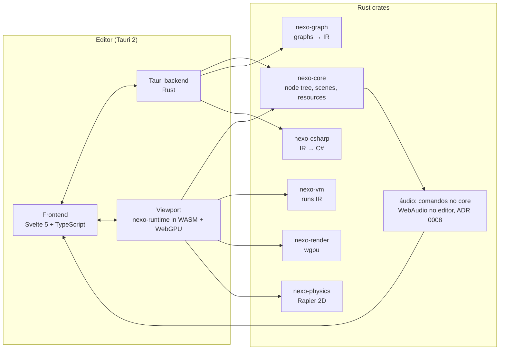

# 03. Architecture

## Overview



## Why these choices

**Tauri 2 for the editor.** Web tech gives the richest UI toolkit with the least effort; the installer stays small because it uses the system WebView.

**Rust for core and runtime.** Memory safety, C++-class performance, strong game ecosystem (wgpu, Rapier) and WebAssembly support. Audio plays through WebAudio in the editor, driven by commands from the core (ADR 0008). C/C++ only through bindings when there is no Rust equivalent.

**Same runtime in editor and game.** The viewport runs `nexo-runtime` compiled to WASM on a `<canvas>` with WebGPU (WebGL2 fallback). What you see in the editor is what the exported game does, and web export comes for free. Validated in WebView2 at 144 fps (see ADR 0002).

**Svelte 5 + Vite.** Fine-grained reactivity for panels with many live fields. Graph editors are drawn on a canvas to handle thousands of nodes.

## Scene model: everything is a node

Following Godot (see [research/godot.md](research/godot.md)):

- A **scene** is a tree of **nodes**. Each node has a type, a name, a stable UID and typed properties.
- Node types form an inheritance chain: `Node → Node2D → Sprite2D`, `Node2D → CollisionObject2D → PhysicsBody2D → CharacterBody2D`.
- A scene can be **instanced** inside another scene (prefab) with per-property overrides.
- **Signals** connect nodes (`body_entered`, `pressed`, `timeout`) and are the entry points for visual scripts.
- A node can have one **visual script** attached; scripts can also be shared assets.
- **Resources** (textures, sounds, physics materials, shapes, fonts) are referenced by UID and can be embedded or saved as files.

Internally the runtime may store nodes in an ECS for performance; users never see the ECS.

## Project format

Text-only, Git-friendly, deterministic key order:

```
MyGame/
├─ project.nexo            # TOML: name, version, settings, input map, layers
├─ scenes/*.scene.ron      # node trees
├─ scripts/*.graph.ron     # visual scripts
├─ assets/                 # source files (PNG, WAV, Aseprite...)
└─ .nexo/cache/            # imported data, git-ignored
```

> Phase 0 uses Portuguese names (`projeto.nexo`, `cenas/`). They move to the English names above in SCN-001, with automatic migration.

## Logic execution

1. The editor saves the graph.
2. `nexo-graph` validates and compiles it to a typed **IR**.
3. `nexo-vm` runs the IR; in play mode new IR is hot-swapped without restarting the scene.
4. `nexo-csharp` generates C# from the same IR.

## Export

| Target | How |
|---|---|
| Windows, macOS, Linux | Native `nexo-runtime` (winit + wgpu) + data pack |
| Web | WASM + WebGPU (WebGL2 fallback) |
| Android, iOS | Later, native wgpu |
