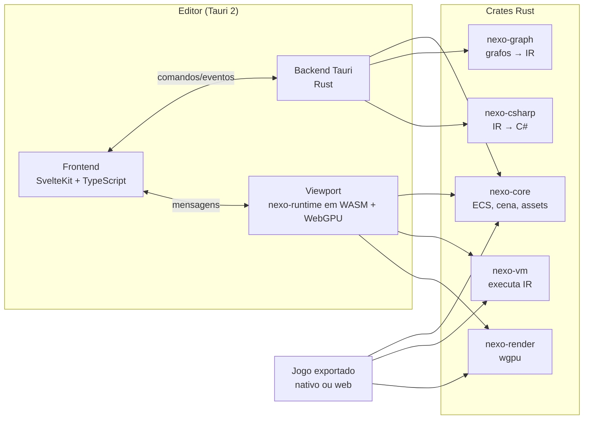

# 03. Arquitetura

## Visão geral



## Por que essas escolhas

**Tauri 2 para o editor.** Permite construir a interface com tecnologias web, onde é possível fazer UI realmente bonita (animações, tipografia, blur, layouts flexíveis) com muito menos esforço do que em ImGui ou Qt. O instalador fica pequeno (usa o WebView do sistema) e o backend é Rust.

**Rust para núcleo e runtime.** Segurança de memória, desempenho de C++, ótimo ecossistema para jogos (wgpu, Rapier, kira, bevy_ecs) e compila para WebAssembly. C ou C++ não trariam vantagem que compense a integração mais difícil com o Tauri.

**O mesmo runtime no editor e no jogo.** O viewport do editor roda o `nexo-runtime` compilado para WASM, renderizando via WebGPU num `<canvas>`. Isso garante que o que se vê no editor é exatamente o que o jogo exportado faz, e de quebra a exportação web sai de graça. Se o WebGPU do WebView de alguma plataforma não for suficiente, há um plano B: janela nativa wgpu sobreposta à área do viewport (ver ADR 0002).

**Svelte 5 + Vite no frontend.** Reatividade fina (runes) e pouco overhead, bom para painéis com muitos campos atualizando ao vivo. O editor é um app de página única, então não há necessidade do roteamento do SvelteKit. O editor de grafos será implementado em canvas/WebGL próprio para aguentar milhares de nós.

## Núcleo

- **ECS** baseado em `bevy_ecs` (ou implementação própria se o acoplamento atrapalhar). O usuário não vê ECS: ele vê **Objetos** com **Componentes** e **Behaviors**, como no Unity/Construct.
- **Cena** é uma árvore de objetos; cenas podem ser instanciadas dentro de outras (prefabs) com overrides.
- **Assets** com ID estável (UUID), importação em segundo plano, hot reload ao salvar arquivos externos (Aseprite, PNG, WAV).
- **Física**: Rapier 2D (e 3D depois).
- **Áudio**: kira.
- **Entrada**: mapeamento de ações ("Pular" → Espaço, botão A, toque).

## Formato de projeto

Tudo em texto para funcionar bem no Git:

```
MeuJogo/
├─ projeto.nexo           # TOML: nome, versão, configurações
├─ cenas/*.scene.ron      # cenas
├─ logica/*.graph.ron     # grafos e folhas de eventos
├─ assets/                # arquivos originais
└─ .nexo/cache/           # importados, ignorado no Git
```

O serializador ordena chaves e IDs de forma determinística para que o diff mostre só o que mudou. O editor terá uma ferramenta de **diff visual de grafos**.

## Execução da lógica

1. O editor salva o grafo.
2. `nexo-graph` valida e compila para **IR** (bytecode tipado).
3. `nexo-vm` executa o IR. No play-in-editor, o IR novo substitui o antigo sem reiniciar a cena (hot reload).
4. `nexo-csharp` gera C# do mesmo IR para visualização e exportação.

Detalhes no documento [04 Programação visual](04-programacao-visual.md).

## Exportação

| Alvo | Como |
|---|---|
| Windows, macOS, Linux | `nexo-runtime` nativo (winit + wgpu) + pacote de dados |
| Web | WASM + WebGPU (fallback WebGL2) |
| Android, iOS | Fase 5, wgpu nativo |
| Consoles | Fora do escopo inicial |

## Comunicação editor ↔ núcleo

- Comandos Tauri tipados (gerados com `tauri-specta`) para operações de projeto.
- Toda edição passa por um **sistema de comandos** com desfazer/refazer ilimitado.
- Viewport e UI trocam mensagens (seleção, gizmos, valores ao vivo para depuração).
