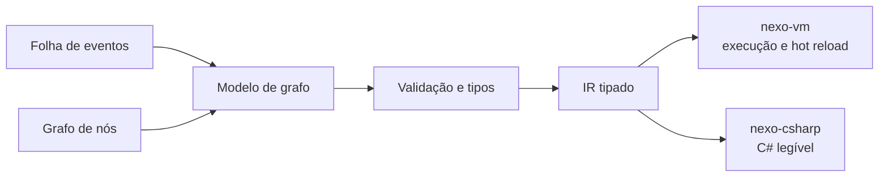

# 04. Programação visual

O coração do Nexo. Há duas formas de editar lógica, ambas sobre o mesmo modelo interno.

## Folhas de eventos (modo simples)

Inspiradas no Construct e GDevelop. Cada linha é um evento:

| Condições | Ações |
|---|---|
| Ao pressionar **Pular** · Jogador **está no chão** | Jogador: aplicar impulso (0, -400) · Tocar som `pulo.wav` |
| Jogador **colide com** Moeda | Moeda: destruir · Pontos += 1 |
| A cada **2 segundos** | Criar Inimigo em (aleatório 0..800, -32) |

Recursos: sub-eventos, grupos recolhíveis, condições OU, laços "para cada", comentários, ativar/desativar linhas.

## Grafos de nós (modo avançado)

Inspirados nos Blueprints:

- **Pinos de execução** (setas brancas) definem a ordem; **pinos de dados** (coloridos por tipo) levam valores.
- **Eventos**: Ao iniciar, A cada frame, Ao colidir, Ao receber sinal, Ao pressionar ação.
- **Funções** com entradas e saídas, **variáveis** locais e do objeto, **macros**, **sinais** personalizados.
- **Nós puros** (sem execução, só calculam) e **nós latentes** (Esperar 1s, Mover até, Tween) que pausam o fluxo sem travar o jogo.

### Tipos e cores

| Tipo | Cor |
|---|---|
| Execução | Branco |
| Booleano | Vermelho |
| Inteiro | Ciano |
| Decimal | Verde |
| Texto | Rosa |
| Vetor | Amarelo |
| Objeto | Azul |
| Cor | Roxo |
| Lista/Mapa | Cor do item com contorno |

## Conversão entre modos

Folha de eventos → grafo é sempre possível (cada evento vira um nó de evento + Branch + ações). Grafo → folha só é possível quando o grafo tem forma de evento simples; caso contrário a folha mostra um bloco "Grafo" embutido que abre o grafo ao clicar.

## Abstrações de alto nível

O que faz o visual ser mais rápido que digitar:

- **Behaviors prontos**: Plataforma, Movimento 8 direções, Top-down, Projétil, Sólido, Arrastar e soltar, Seguir caminho, Câmera que segue, Vida/Dano, Piscar, Destruir fora da tela.
- **Máquina de estados visual** para personagens e IA (Parado → Correndo → Pulando).
- **Tweens** e **timelines** como nós.
- **Diálogos** com editor de árvore de diálogo.
- **Behaviors do usuário**: qualquer grafo pode ser publicado como behavior com parâmetros no Inspector, compartilhável entre projetos.

## Experiência de edição

- Arrastar um fio para o vazio abre busca **filtrada pelo tipo** do pino.
- Busca difusa em português e inglês ("pular", "jump").
- Arrastar variável do painel cria Get; com Alt cria Set.
- Selecionar nós e **Ctrl+Shift+F** colapsa em função.
- Alinhamento e **organização automática** de layout.
- Comentários coloridos que agrupam nós e se movem juntos.
- Nós reroute, minimapa, zoom semântico (de longe, mostra só títulos).
- Erros aparecem no nó com explicação em linguagem humana e sugestão de correção.

## Depuração

- Fios acendem e pulsam quando a execução passa.
- Passar o mouse num pino mostra o valor atual.
- Breakpoints em nós, execução passo a passo, inspeção de variáveis.
- Seletor de instância: depurar "este inimigo" entre vários.
- Linha do tempo de execução: voltar alguns frames e ver o que aconteceu.

## Modelo interno e IR



- O IR é uma sequência de blocos básicos com registradores tipados, fácil de interpretar rápido e fácil de traduzir.
- Nós latentes viram **corrotinas** no IR.
- Cada instrução guarda o ID do nó de origem, permitindo mapear erros e breakpoints de volta ao grafo.
- Otimizações simples: dobra de constantes, remoção de código morto, cache de nós puros por frame.

## C# como linguagem de saída

Opinião sobre a escolha: **C# é uma ótima escolha** como linguagem textual. É legível, tipada (combina com os pinos tipados), muito conhecida por quem vem da Unity e o código gerado ensina programação de verdade.

O cuidado é com a execução. Embutir o runtime .NET no jogo aumenta o tamanho e complica a exportação web e mobile. Por isso a proposta é:

1. **Fase inicial:** o jogo executa o IR na `nexo-vm` (Rust). O C# é gerado para **visualizar, aprender e exportar** ("ejetar" para código).
2. **Fase futura:** scripts C# escritos à mão, executados via .NET hospedado (hostfxr) no desktop e NativeAOT/WASM onde der. Nesse ponto grafos e scripts C# podem se chamar mutuamente pela mesma API.
3. **Opcional:** Lua como linguagem leve de modding, se fizer sentido.

Exemplo do evento de pulo gerado em C#:

```csharp
public partial class Jogador : NexoBehaviour
{
    [Export] public float ForcaPulo = 400f;

    protected override void OnActionPressed(InputAction action)
    {
        if (action == Actions.Pular && Platformer.IsOnFloor)
        {
            Body.ApplyImpulse(new Vector2(0, -ForcaPulo));
            Audio.Play(Assets.Sons.Pulo);
        }
    }
}
```

A API C# (`NexoBehaviour`, `Body`, `Audio`) é a mesma que os nós expõem: cada nó corresponde a um método documentado. A documentação dos nós e da API sai de uma única fonte.
