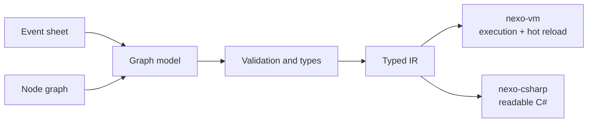

# 04. Visual programming

Nexo's core. Two editing styles over one model, organized the GameMaker way: **scripts are assets** listed in the Project browser, attached to nodes, and made of **events**.

## Scripts as assets (GameMaker style)

- The Logic workspace has a **script list** (Script 1, Script 2, ...) with create, rename, duplicate, delete and folders.
- Each script has an **events list** on the side: *On Ready (Create)*, *On Process (Step)*, *On Physics Process*, *On Collision with...*, *On Input Action*, *On Signal*, *On Draw*, *On Destroy*.
- Selecting an event opens its graph on an **infinite canvas**: pan with middle mouse, Space+drag or dragging the background; zoom with the wheel; right-click opens the **node search menu**.
- A script is attached to a node from the Inspector (`Script` slot) or by dragging it onto the node in the Hierarchy.

## Node graphs (advanced)

- **Execution pins** (white arrows) define order; **data pins** (colored by type) carry values.
- Functions with inputs/outputs, local and node variables, macros, custom signals.
- **Pure nodes** compute values; **latent nodes** (Wait, Move To, Tween) pause the flow without blocking the game.

| Type | Color |
|---|---|
| Exec | White |
| Bool | Red |
| Int | Cyan |
| Float | Green |
| String | Pink |
| Vector2 | Yellow |
| Node reference | Blue |
| Color | Purple |

## Event sheets (simple)

Inspired by Construct and GDevelop: rows of conditions → actions. Every sheet converts to a graph; graphs with a simple event shape convert back.

## High-level abstractions

What makes visual faster than typing: built-in node types with behavior (CharacterBody2D platformer controller, Area2D, Timer, AnimationPlayer), state machines, tweens, dialogue trees, and user-made behaviors publishable as reusable nodes.

## Editing experience

- Dragging a wire into empty space opens search filtered by pin type.
- Fuzzy search in English and Portuguese ("jump", "pular").
- Collapse selection to function, auto layout, reroute nodes, colored comment boxes, minimap, semantic zoom.
- Errors appear on the node with a human explanation and a suggested fix.
- The animated dashed execution wires and the dotted canvas background from the Phase 0 preview stay as the visual reference.

## Debugging

Wires pulse when execution passes, pin values on hover, breakpoints, step, instance picker, per-frame execution timeline.

## IR and VM

Latent nodes become coroutines; every instruction keeps its source node ID for errors and breakpoints.

## C# as the textual language

C# is readable, typed (matches typed pins), familiar to Unity users, and GameMaker's own roadmap also points to C# as an interoperable language ([GameMaker roadmap, spring 2026](https://gamemaker.io/en/blog/update-spring-2026)). Games run the IR in `nexo-vm`; C# is generated for reading, learning and ejecting. Hand-written C# scripts come later on the same API.
