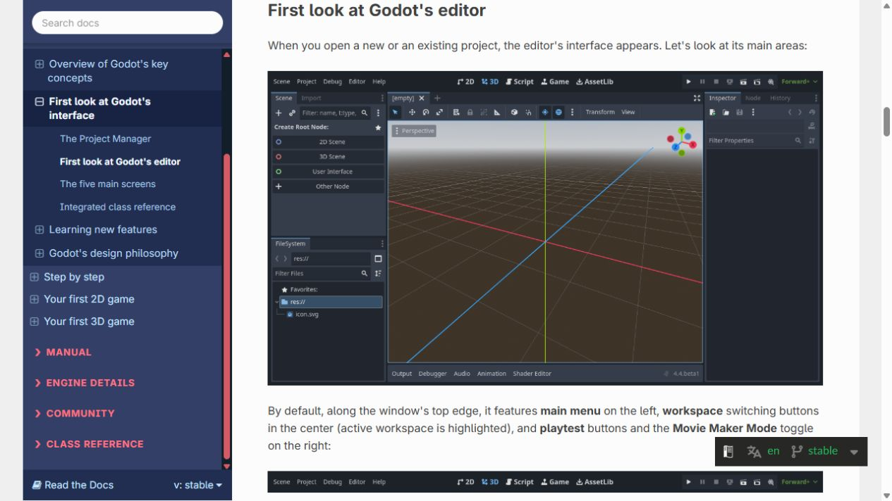
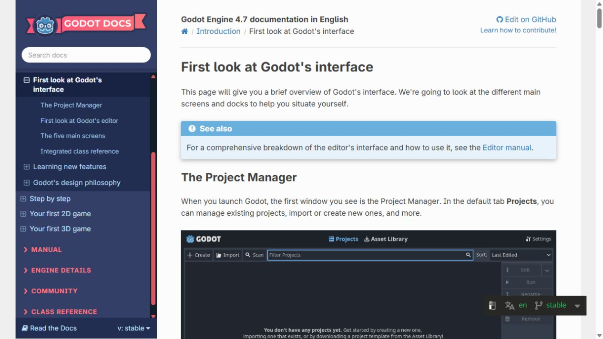
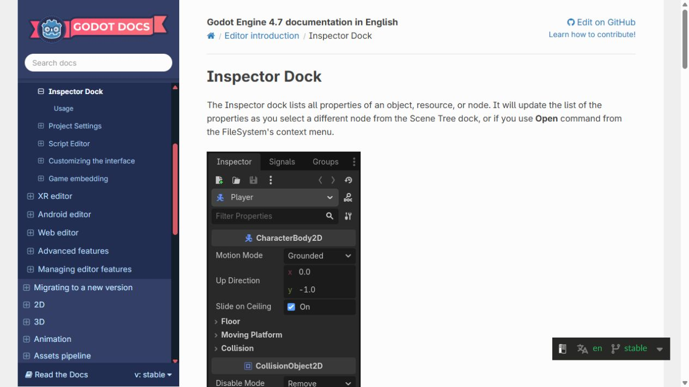
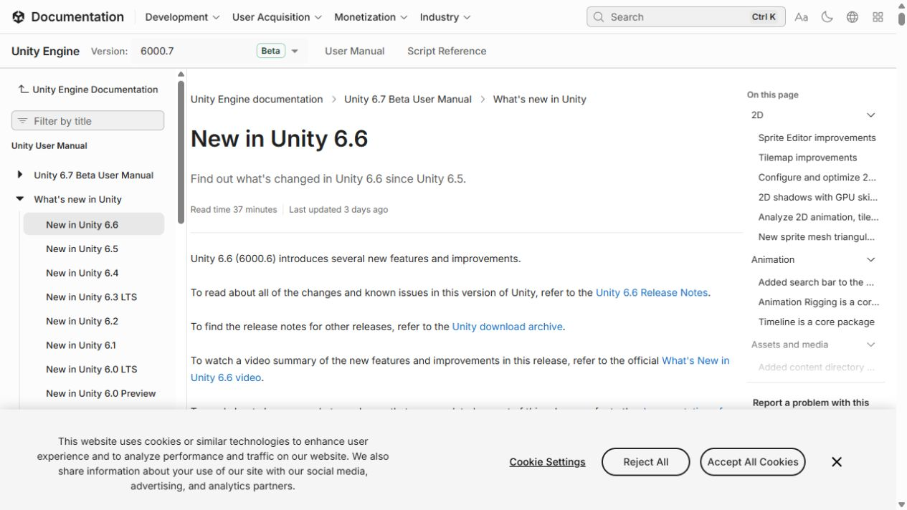
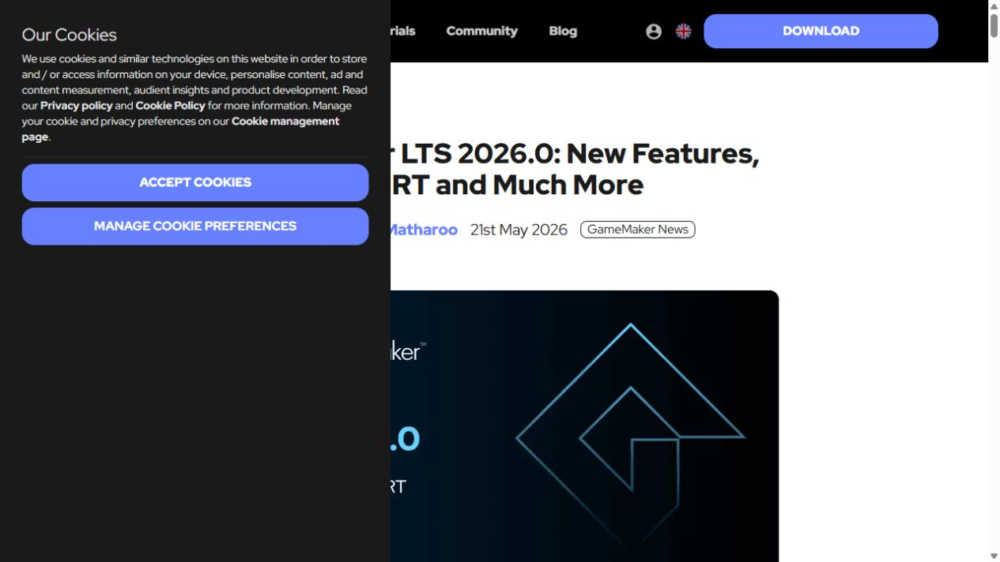

# Research screenshots

Captured on 2026-10-05 from official pages, for internal reference only. Rights belong to their owners; replace with our own captures of the editors when DOC-004 is done.

| File | What it shows | Source |
|---|---|---|
|  | Godot editor: Scene dock, FileSystem, viewport, Inspector/Node tabs, bottom panels | [Godot docs: First look at the editor](https://docs.godotengine.org/en/stable/getting_started/introduction/first_look_at_the_editor.html#first-look-at-godot-s-editor) |
|  | Godot docs page and Project Manager | [Godot docs](https://docs.godotengine.org/en/stable/getting_started/introduction/first_look_at_the_editor.html) |
|  | Godot Inspector dock documentation | [Inspector dock](https://docs.godotengine.org/en/stable/tutorials/editor/inspector_dock.html) |
|  | Unity 6.6 what's new (2D section index) | [Unity docs](https://docs.unity.com/en-us/engine/6000.7/manual/whats-new/unity66) |
|  | GameMaker LTS 2026.0 announcement | [GameMaker blog](https://gamemaker.io/en/blog/lts-2026-release) |
